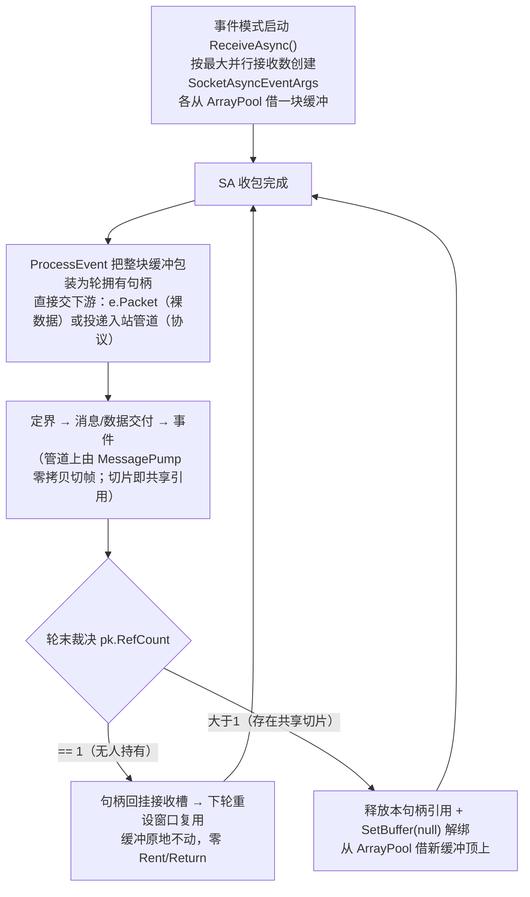
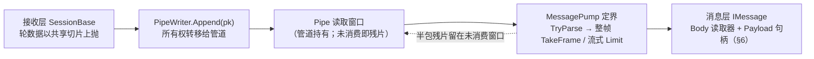

# 网络层零拷贝缓冲所有权架构

> 适用范围：NewLife.Core 网络接收链路（SocketAsyncEventArgs → SessionBase → 入站管道/协议帧泵 → 消息层），
> 以及 NewLife.Remoting 的消息消费层（ApiClient 等）。
> 本文档描述"每次接收自有池化缓冲、所有权随包上移"的架构约定，是所有网络代码的内存规则基线。

> **文档基线**：本文档与当前分支（目标 v12）代码一一对应，不包含任何早期中间态/历史补丁描述。
> 要点速览：数据带出本轮的唯一通道是 `IPacket.Slice()`（共享切片，切出方持有引用、用后 Dispose；下游拿到的轮拥有句柄可直接交付应答/发送链路消费）；
> 接收层判断缓冲是否需换新的唯一信号是轮末轮句柄的 `RefCount`（==1 无人持有则句柄回挂接收槽、下一轮重设窗口复用；大于1 存在跨轮共享切片，解绑换新）；
> 定界与解码由消息帧泵 `MessagePump` + 无状态协议 `IMessageCodec` 承担（从管道窗口 `TakeFrame` 零拷贝切帧、头部到齐即出消息、残片留在管道未消费窗口），见《消息协议栈.md》；
> 数据管道（`Pipe`）投递使用同一共享切片通道（`Writer.Append` 无条件转移所有权；轮末按 `RefCount` 自动换新缓冲，暂停水位时挂起接收事件参数），见《数据管道Pipe.md》。

## 1. 目标

- **极致吞吐**：仅接收并上抛到应用层的路径，做到每消息零堆分配（零 GC）；
- **零拷贝**：接收 → 拆帧 → 协议解码 → 事件派发，全程切片不拷贝；
- **可维护**：用"所有权"规则从根上消除"借用视图被异步持有/跨线程使用"类踩坑。

## 2. 核心原则（两条铁律）

| 原则 | 说明 |
|---|---|
| **借阅视图只在本轮同步栈内有效** | `ArrayPacket`/`Memory<byte>` 等视图只允许在"本线程、本轮、同步"调用栈中使用，禁止保存到异步上下文、禁止跨线程传递。 |
| **所有权对象谁拿谁还，引用计数** | 池化缓冲（`ArrayPool` 借出）由 `ArrayOwner` 引用计数管理：`Slice` 为共享切片（每段递增计数、各句柄独立释放），最后一个引用归零时归还缓冲。 |

## 3. 接收缓冲生命周期（首轮包装句柄，之后回挂复用；有共享切片才换新）

规则：
1. 事件模式（`AutoReceive=true`）会话启动按最大并行接收数（TCP 默认 1，UdpServer 默认 CPU×1.6）创建并发接收 `SocketAsyncEventArgs`，每块从 `ArrayPool<Byte>.Shared` 借缓冲（`BufferSize`）；把整块缓冲包装为轮拥有句柄直接上抛（首轮包装，之后无外部持有时回挂复用，换新缓冲时才重新包装；下游可直接消费或交给应答/发送链路，需跨轮带出时在事件内经 `Slice` 切出共享切片）；轮末按引用计数裁决：计数为 1（无人持有）则把句柄回挂接收槽（不脱手、不新建），下一轮用 `OwnerPacket.Resize` 把窗口重设到本段数据即可复用同一句柄（缓冲与引用计数对象都不重建）；否则（已被下游消费归零、或存在共享切片）释放本句柄并解绑、换新缓冲（旧缓冲由最后释放的共享切片归还）；
2. 逃逸（跨线程/跨 await 携带）必须经 `Slice` 切出独立共享句柄（引用计数持有）；下游对轮句柄的消费/释放只作用于本轮，不影响其它轮次的缓冲归属；
3. 归还路径：①无人带出的缓冲由 `ReleaseRecv` 在会话关闭/断开时 `ArrayPool.Return`；②被带出的缓冲由最后一个共享句柄 `Dispose` 时归零归还；换新前先解绑（`SetBuffer(null)`），避免把已带出的旧缓冲二次归还（双重归还将引发脏读）。
4. 拉取模式（打开前设 `AutoReceive=false`）不启动接收环：`Receive/ReceiveAsync` 直接读 Socket，句柄由调用方释放，不参与轮末裁决。

## 4. Slice 共享切片：数据带出本轮的唯一通道

### 4.1 四条路径（三条合法 + 一条违禁）

| # | 场景 | 代码位置 | 频率 |
|---|---|---|---|
| ① | **RPC 响应交付**：命中 await 等待方，响应消息整体交付（等待方 `Dispose` 消息即归还体） | `SessionBase.TryMatchResponse` → `IMatchQueue.Match` 交付等待方任务 | 常见 |
| ② | **半包残片保留**：数据不完整时残片留在管道未消费窗口跨轮累积（大帧跨轮必经） | `Pipe` 读取窗口（投递时已转移给管道的共享切片） | 大帧下常见 |
| ③ | **事件处理器主动带出**：事件内把当前帧带出本轮（跨线程/跨 await） | 业务代码：事件内 `e.Packet.Slice(...)`（裸数据模式）；协议模式经 `e.Message.Body` 读取或先物化 | 罕见 |
| ✗ | **意外逃逸**：不经 `Slice`，私自留存轮句柄或借用视图 | 任意代码（违规） | 必须评审拦截 |

- 三条合法路径语义完全一致：**切片即共享引用**（`Slice` 返回独立句柄，每句柄各自 `Dispose`，最后一个释放时缓冲归零归还）；
- **接收链路统一契约**：接收层每轮发放的是拥有句柄，下游任何组件（事件订阅者、编解码器、匹配队列、应答链）按同一纪律处理——同步消费直接用，跨轮带出先 `Slice`；
- 意外逃逸（第 ✗ 条）的防护只有一层：**跨轮带出必须 `Slice`**（切片使 `RefCount` 大于 1，轮末裁决随即解绑换新，逃逸方拿到的缓冲不会再被复用）；**未 `Slice` 而私自留存的轮句柄或借用视图都没有运行时保护**——轮末句柄回挂接收槽、下一轮被 `Resize` 重设窗口，私存的引用此后读到的是新一轮数据（或正被覆盖的缓冲），属静默脏读，**不会**抛 `ObjectDisposedException`；评审必须拦截把轮句柄/视图存入字段、异步上下文、队列或跨线程传递。

### 4.2 切片原语与轮末裁决

- `IPacket.Slice(offset, count)`：共享切片（引用计数），各方各自 `Dispose`，最后一个释放时归还池；跨段自动组链、每段独立计数；
- `OwnerPacket.Detach()`：脱手（放弃本句柄引用但不归还缓冲），仅当计数为 1 时可用，供接收层在**会话关闭**时把常驻缓冲的归还责任交给 `ReleaseRecv`（不再用于轮末复用）；
- 轮末唯一判据：轮句柄的 `RefCount`——为 1 则句柄回挂接收槽、下一轮重设窗口复用；非 1（消费归零或存在共享切片）则释放本句柄并换新；
- 借用视图（`ArrayPacket` 等）不参与计数，仅本轮同步有效。

### 4.3 事件期间 Packet 的指向（按模式）

| 阶段 | `Packet` 指向 | 说明 |
|---|---|---|
| 裸数据模式（`Protocol == null`） | 整轮轮拥有句柄 | `ProcessEvent` 包装后直接上抛，事件处理器同步读取 |
| 协议模式（`Protocol` 非空） | 当前消息体（`message.Payload`；流式体为 null） | `OnMessage` 构造事件参数，`e.Message` 为消息本体；处理器返回后消息即收尾（未读体丢弃、消息释放） |

- 裸数据模式：需要带出本轮的数据在事件内经 `Slice` 切出共享切片，与轮末裁决互不影响（切片使计数大于 1，接收层随即解绑换新）；
- 协议模式：`e.Packet`/`e.Message` 与消息同生命周期，事件返回后失效；需要跨轮携带必须在处理器内 `Slice` 或物化（`Body.ReadAllAsync`），或改用异步入口 `OnMessageAsync` 在 `await` 期间消费。消息本体的所有权不在事件参数上——未命中的消息由框架收尾，命中的消息交付等待方（§6）。

### 4.4 接收层的响应（一条规则）

- 轮末检查轮句柄 `RefCount`：**等于 1（无人持有）→ 句柄回挂接收槽，下一轮 `Resize` 重设窗口复用（缓冲原地不动，零 Rent/Return、零分配）；大于 1（存在跨轮持有的共享切片）或已归零（被下游消费）→ 释放本句柄引用、`SetBuffer(null)` 解绑，从 `ArrayPool` 借新缓冲顶上**；
- **启用入站管道（`Pipe`）的会话恒走换新分支**：每轮数据以共享切片投入管道（§5.2），轮句柄计数必然大于 1；“零 Rent/Return”复用只发生在未启用管道的会话上（换新为池化往返，实测约 8ns/次，代价可忽略）；
- 解绑先于借新：若 Rent 抛出（如 OOM），`se.Buffer` 已为 null，`ReleaseRecv` 不会把已被带出的旧缓冲二次归还（双重归还将引发脏读）。

## 5. 拆帧与协议解码（帧泵 MessagePump + 协议 IMessageCodec）

拆帧层只回答两个问题：**切出什么帧**（形态与所有权）、**是否消费**（推进到哪）；
帧能否逃逸（跨 await）由消息层 §6 决定——帧泵不预知帧是被 await 的响应还是同步推送。

### 5.1 帧三态与所有权速查

| 帧/体形态 | 场景 | 所有权与可持有性 |
|---|---|---|
| 借阅视图 `ArrayPacket` | 借用句柄/外部缓冲输入 | 无所有权；落在原拥有者缓冲，仅同步链路内有效，禁止跨轮/跨线程持有；投入管道前必须先换自有句柄 |
| 共享切片 `OwnerPacket` | `TakeFrame` 切出整帧 | 引用计数共享底层缓冲，可跨轮持有；各句柄 `Dispose`，最后一个归还 |
| 切片链 `OwnerPacket.Next` | 跨段帧（跨多个管道片段） | 链上每段各持一份引用；`Dispose` 链头递归释放全部段 |
| 流式体 `LimitedReader` | 帧未完整（头部已到齐） | 不拥有内存；跟在管道窗口上随数据到达，交付收尾经 `MessagePump.DiscardAsync` 对齐帧尾 |
| 管道读取窗口 `PipeReader.Buffer` | 泵看到的原始窗口 | 管道持有；仅对应数据被消费前有效，禁止跨轮缓存（跨轮请 `TakeFrame` 或 `Slice`） |

本文档只强调**所有权规则**；帧格式、算法与协议实现细节见《消息协议栈.md》。

### 5.2 残片保留规则（跨轮残片 = 管道持有未消费窗口）

- **半包**：`TryParse` 返回 `null` 时帧泵不消费任何字节，残片留在管道未消费窗口跨轮累积，零拷贝（不再有按会话的缓存链与拼段拷贝）；
- **轮末裁决恒定换新**：投递入管道用的是轮数据的共享切片（`pk.Slice(0, -1)`），轮句柄 `RefCount` 必然大于 1 → 启用管道的会话每轮解绑换新缓冲（「零 Rent/Return」复用见 §4.4）；管道内的切片按消费进度释放，会话关闭时随管道释放；
- **无接收层句柄的通道**（自有缓冲直接投递，如 `Http/WebSocket` 服务端同步泵）→ 借用视图不得直接追加：`PipeWriter.Append` 只接受真正拥有内存的句柄（`OwnerPacket` 或按池化数组构造的 `ArrayPacket`），借用视图须先克隆为自有拷贝；
- **防护**：残余无法定界且达到 `MaxCache`（默认 1M）说明对端数据与协议不匹配或已损坏，`ReadAsync` 抛异常 → `OnError` + 关闭会话，避免连接僵死（`TryRead` 为不等待版本，不执行该检查）。

### 5.3 定界契约（IMessageCodec.TryParse）

- `TryParse(ReadOnlySequence<Byte>)` 从帧首窗口定界，**三态返回**：`null` = 数据不足（不消费、不产生对象，等下一轮）；`ParseResult { Invalid = true }` = 帧损坏（长度非法等），帧泵立即抛异常而不再静默丢弃；其余为已定界帧（`Message` 为 null 表示无消息帧，按 `HeaderSize` 跳过）；
- **成功即有进展**：成功返回必须消费至少 1 字节，否则帧泵空转；
- **`NeedFullFrame`**：标记「已定界但体需整帧到齐」（如压缩装饰器内层未完整），帧泵据此跳过 `MaxCache` 残余防护，避免大帧被误判为坏帧；
- 头部可跨段：用 `SequenceReader<Byte>` 跨段拼读（全 TFM 兼容），不物化整帧；帧长 = `HeaderSize + BodyLength`，`BodyLength` 为 `Int64` 不溢出。

### 5.4 内置协议与消息的适配

- 内置协议（`SrmpCodec`/`SplitDataCodec`/`LengthFieldCodec`/`WebSocketCodec`/`CompressedCodec`）均为**无状态 `IMessageCodec`**，可跨连接共享；帧格式与特性见《消息协议栈.md》§4。装饰器（压缩/加密）在 `TryParse` 内变换并把结果预绑定到消息体，帧泵检测到已绑定体时直接消费整帧，不再二次绑定；
- 消息侧契约（`IMessage`）：`Body` 为体读取器（整帧快路径为内存视图、慢路径为流式）；`Payload` 为体的内存句柄，是**唯一所有权载体**（发送模式零拷贝）；`SetBody(null)` 表示放弃持有（所有权已交付调用方或构建结果）；`Dispose` 为体唯一归还点，未读余量由交付收尾丢弃（`MessagePump.DiscardAsync`）；
- **会话层不再有按会话的编解码器缓存**：粘包状态、残片、未消费窗口全部落在每会话一个的入站管道（`Pipe`）上，协议实例不持有任何连接级状态（曾因处理器实例字段存跨会话状态而串包）；
- **连接级状态由通道对象持有**：如 WebSocket 分片重组由 `Http/WebSocket`（服务端）与 `WebSocketClient`（客户端）累积完成，`WebSocketCodec` 只做帧编解码、不直接装给 `SessionBase.Protocol`。

## 6. 请求/响应匹配与事件顺序（消息层归属）

先事件后匹配；匹配按协议配对能力（实现：`SessionBase.ProcessMessageAsync` → `OnMessageAsync` → `TryMatchResponse`）：

1. **先触发事件（`Received` 事件链），后匹配等待方**——监视型订阅者先同步看到消息与体，等待方 continuation 异步执行，与同步事件链无竞态；
   - **生命周期互不影响**：事件订阅者跨轮持有数据必须在处理器内 `Slice` 切出独立共享切片（计数加一）；订阅者持有不影响匹配交付，匹配交付也不影响订阅者手中的切片，各自 `Dispose` 归零后才归还池；
2. **匹配判定**：取该会话的 `MatchQueue`（发过等待请求才存在）与协议的 `IMessageMatcher`（装饰协议逐层解包找内层配对器）；任一缺失即快速返回，无额外开销；
3. **命中交付**（响应对上等待中的请求）：响应消息整体交付等待方（`SendMessageAsync` 的 await 方拿到 `IMessage`，其 `Dispose` 即归还体），框架**跳过收尾**；内存模式体在交付前复位到起点（事件链可能已读空同一份体，零拷贝复用），流式体在交付前物化为内存模式（一次拷贝换等待方可任意时机消费）；
4. **未命中收尾**：框架丢弃未读体对齐下一帧（`MessagePump.DiscardAsync`）后释放消息（`TryDispose`）；无人等待的应答因此不会泄漏缓冲；
5. **并行处理（`MaxConcurrency` 大于 1，默认 1）**：派发前物化流式体（脱离管道独立可用），信号量限并发（满额时等待，兼作背压）；处理顺序不定，要求业务处理器线程安全；默认串行（前一条收尾后才读下一帧）。

## 7. 所有权转移与归还总表

| 场景 | 缓冲申请 | 所有权去向 | 归还点 |
|---|---|---|---|
| 纯接收、同步消费（裸数据模式，无管道） | 池化接收缓冲（首轮包装句柄，之后回挂复用） | 无人持有（计数为 1） | 轮末句柄回挂、下一轮重设窗口复用，不归还 |
| 投递入站管道（协议模式） | 轮数据共享切片（`pk.Slice(0, -1)`） | 管道持有，按消费推进释放 | 管道消费/关闭时释放；轮句柄解绑后由最后释放的切片归还 |
| 帧泵切帧（帧已完整） | `TakeFrame` 切出共享切片 | 消息体（`Payload`）独立持有 | 消息 `Dispose`（未读余量先 `DiscardAsync`） |
| 帧泵流式体（帧未完整） | 管道窗口限长视图 `Limit` | 不拥有内存，跟随窗口 | 交付收尾 `DiscardAsync` 对齐帧尾 |
| 匹配响应命中 | 消息（体为帧切片，流式已物化） | 整体交付等待方 | 等待方 `Dispose` 消息 |
| 未命中（请求/推送/无人等待的应答） | 消息（帧切片） | 框架收尾 | `DiscardAsync` 丢弃未读体 + `TryDispose` 释放消息 |
| 事件监视跨轮持有 | 帧切片 | 处理器内 `Slice` 独立持有 | 持有方 `Dispose` |
| 直发（`Send` 系列） | 调用方句柄（借用语义） | 不转移，写锁内散列写出，写完才返回 | 调用方 `Dispose` |
| 发送队列（可选第二出口 `SendQueuedAsync`） | 入队句柄 | **入队即转移**给队列 | 发送泵写出后由队列释放 |
| 会话关闭 | 管道未消费窗口 + 接收槽缓冲 | 网络层 | 管道写侧完成、残余释放；`ReleaseRecv` 归还 `se.Buffer` |

## 8. 禁止事项（踩坑清单）

- ❌ 在事件回调之外持有 `Memory`/`ArrayPacket` 视图；
- ❌ 把视图存进异步状态机、`Task`、`ConcurrentQueue`、类字段；
- ❌ 头部扩展（`ExpandHeader` 原地接管）后继续读取源实例（源已整体作废，数据访问抛 `ObjectDisposedException`；后续一律使用返回的新实例）；
- ❌ 接收层在轮句柄计数大于 1 时仍复用该缓冲（必须解绑换新；旧缓冲由最后释放的切片归还）；
- ❌ 匹配逻辑对已独立持有的负载再做二次克隆（丧失零拷贝收益）；
- ❌ 事件处理器手工置空/改写 `e.Packet`（需要带出本轮时在事件内经 `Slice` 切出共享切片；事件参数由框架租借与回收，处理器返回后即失效）；
- ❌ 不经 `Slice` 私自留存轮句柄或借用视图带出本轮（两类留存都无运行时保护：轮末句柄回挂、下一轮被 `Resize` 重设窗口，留存方读到的是新一轮数据——静默脏读，评审必须拦截）；
- ❌ 对同一缓冲“共享了却期望自动归还”（共享≠免释放：每个句柄都必须 `Dispose`，否则计数不归零、池缓冲流失）；
- ❌ 把借用视图（`ArrayPacket` 等）交给异步上下文/存储后继续使用（借用视图只在本轮同步调用栈内有效）；把借用视图直接 `Append` 进管道（管道只接受真正拥有内存的句柄，须先克隆为自有拷贝）；
- ❌ 在协议实例（`IMessageCodec`）上保存连接级状态（协议跨连接共享，会串帧串包；连接级状态放通道对象或会话）；
- ❌ 协议模式下把 `e.Packet`（消息体视图）或 `e.Message` 存起来跨轮使用——消息在处理器返回后即收尾（未读体丢弃、消息释放），跨轮携带必须在处理器内 `Slice`/物化，或改用异步入口 `OnMessageAsync` 在 `await` 期间消费。

## 9. 验证与测试基线

当前实现由 `XUnitTest.Core` 覆盖，关键测试点：

| 域 | 覆盖点 | 主要测试 |
|---|---|---|
| 帧泵与协议 | 头部到齐即交付、整帧零拷贝切帧、流式体、无消息帧跳过、`Invalid` 抛错、`MaxCache` 防护、装饰协议 | `Messaging/MessagePumpTests`、`Messaging/LengthFieldCodecTests`、`Messaging/SplitDataCodecTests`、`Messaging/WebSocketCodecTests`、`Messaging/CompressedCodecTests` |
| 消息与所有权 | 头部/超大包/跨段解析、`SetBody`/`Payload` 归属、`Dispose` 唯一归还、`DiscardAsync` 对齐帧尾 | `Messaging/DefaultMessageTests`、`Messaging/MessageDisposeTests`、`Messaging/MessageContractTests` |
| 数据包与切片 | `Slice` 共享切片计数、链式各段独立计数、`Detach`/`Resize`、借阅视图 | `Data/IPacketTests`、`Data/OwnerPacketTests`、`Data/ArrayPacketTests`、`Data/PacketHelperChainTests`、`Data/PacketSequenceTests` |
| 管道 | `Append` 所有权转移、`TakeFrame`/`Limit`、推进与残片、背压水位、挂起提交单写纪律 | `Data/PipeTests`、`Net/SessionPipeTests`、`Net/TcpSessionStreamTests`、`Net/TcpSessionSendQueueTests` |
| 网络集成 | TCP/UDP/UDS/WS 收发、请求-响应匹配、事件先于匹配、轮末按引用计数换新/复用、无等待方应答安全归还 | `Net/MessageSessionTests`、`Net/UdpMessageSessionTests`、`Net/UnmatchedReplyTests`、`Net/UdsNetServerTests`、`Integration/NetworkServerIntegrationTests` |
| WebSocket | 帧解析（掩码/扩展长度/控制帧）、分片重组、链式大帧零拷贝、多会话并发隔离 | `Messaging/WebSocketCodecTests`、`Integration/WebSocketIntegrationTests`、`Net/WebSocketHandshakeTests`、`Net/WebSocketPullTests` |
| 高吞吐 | 变长大帧跨段组链、批量路径零拷贝 | `Integration/HighThroughputCodecTests` |

> 全量基线以 `XUnitTest.Core` 为准：net10.0 全量 3209 用例（3200 通过 / 0 失败 / 9 跳过，2026-10-04 实测）；最低 TFM（net45 / netstandard2.0）与 net10.0 编译零错误。
> 任何代码改动保持“编译 + 相关测试全绿”后再提交。

## 10. 演进方向（未定 / 待评估）

### 已落地
- 切片模型统一：`Slice` 一律返回引用计数共享句柄（`transferOwner` 参数被忽略，`Share` 删除），新增 `RefCount` 观测与 `Skip` 窗口前移，`Free` 退役（`Detach` 取代）；三参 `Slice` 兼容壳**保留**（以 `[Obsolete]` 短转发两参重载，供旧二进制加载，语义按引用计数共享）；
- `Slice` 返回类型收窄：`OwnerPacket.Slice` 公开返回具体类型（可直接 `using`），`IPacket.Slice`/`IOwnerPacket.Slice` 为显式接口实现；**属 v12 破坏性变更**——对旧版编译、以具体类型接收者调用两参 `Slice` 的二进制会抛 `MissingMethodException`（CLR MemberRef 绑定含返回类型）。按组件统计（扫描 1.5 万 DLL，不含单元测试）：产品组件仅 **NewLife.MySql**（`AuthenticateAsync` 等 4 处调用点，覆盖全部已发布版本），随同步重编译发版消除、源码零改动；其余产品组件不受影响（Remoting 仅三参调用、MQTT/Modbus/Video 等仅接口调用）。三参兼容重载与 `IPacket.Slice` 签名不变；外部自定义 `IOwnerPacket` 实现类需补实现该接口成员；
- 接收层轮句柄复用 + 轮末引用计数裁决：计数为 1 → 句柄回挂接收槽、下轮重设窗口复用（零 Rent/Return、零分配）；否则解绑换新；缓冲归还恰好一次；启用入站管道的会话恒定换新（管道持有共享切片）；
- **定界与解码重构**：`PacketCodec`/`PacketFramer` 与 6 个 Handler 编解码器、`WebSocketMessage` 整删，改为无状态 `IMessageCodec` + `MessagePump` 帧泵（头部到齐即交付、整帧 `TakeFrame` 零拷贝、大帧流式不整载）；
- **会话协议入口**：`Protocol` 属性（`NetClient.Protocol`/`NetServer.Protocol`/裸 `SessionBase.Protocol`），`MaxCache`/`MatchTimeout`/`MaxConcurrency` 随监听服务下发；`ISocketRemote.Add<T>()` 与 `SendFile`/`SendMessages` 删除；
- **入站通道统一**：连接型会话（TCP/SSL/UDS）每轮数据以共享切片投递入站 `Pipe`，消息泵与 WebSocket 通道共用同一通道；背压由水位暂停接收、`Resumed` 重启收尾；协议无状态、无按会话编解码器缓存；
- **出站收口**：默认“直发 + 一把写锁”（`Send` 系列借用句柄、写完才返回；流式与文件发送分块/内核零拷贝），批量场景可选第二出口 `SendQueuedAsync`（入队即转移所有权，泵与直发共用写锁；关闭不排空，残余直接丢弃归还）；
- 协议解析对链式帧零物化：`SrmpCodec` 头部 `SequenceReader` 跨段拼读、`WebSocketCodec` 掩码逐段 XOR、`CompressedCodec` 整帧解压并设 `MaxDecompressedSize` 上限（默认 16M，防解压炸弹）；
- WebSocket 通道闭环：服务端 `Http/WebSocket` 与客户端 `WebSocketClient` 在交付前完成掩码解码与分片重组（`WebSocketCodec` 只做帧编解码，不直接装给 `SessionBase.Protocol`）；
- 匹配未命中的应答（无等待方）由框架收尾丢弃未读体并释放，不再无人释放。

### 仍开放
1. **生态适配复核**：`NewLife.Remoting`（`ApiMessage`/`EncoderBase`/`HttpMessage` 等）对 `IMessage.Payload` 的新所有权语义与 `Protocol` 入口迁移需逐仓确认（旧 `Add<T>()`/Handler 链调用已无对应物）；
2. **兼容垫片清理**：`Free` 已随 v12 删除（破坏性）；三参 `Slice` 壳保留（引用计数共享语义），供旧二进制直接加载，按返回类型绑定 `Slice` 的旧调用方（如 `NewLife.MySql`）仍建议重编译发版；
3. **零 GC 压榨**：热点实例池化 + BenchmarkDotNet 量化报告（数据见《内存分配与拷贝成本报告》）；析构兜底按 `#if DEBUG || OWNERPACKET_FINALIZER` 条件编译，发布版零终结开销。

> 逐项推进以"编译 + 全量测试绿"为门槛；属破坏性内容，宜在发版前统一决策。
